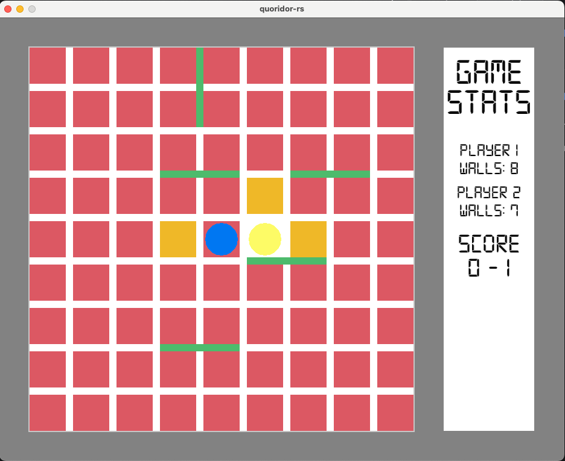

# About
[](https://github.com/dperezmavro/quoridor-rust/actions/workflows/rust-ci.yaml)

This is a small project I have been working on to learn Rust.

quoridor-rust is a small, local, immediate-mode GUI game for the popular board game quoridor.

There is also a webassembly version provided.

# Running

```sh
cargo run                 # native window
make test                 # tests with a tarpaulin coverage report
make run_wasm             # build for wasm32-unknown-unknown and serve bin/wasm/ with basic-http-server
```

The wasm build needs the `wasm32-unknown-unknown` target and `basic-http-server` installed.

# Controls

Left-click a groove between tiles to place a wall for the current player. Left-click a highlighted tile to move the current player's pawn. Players alternate turns; each has 10 walls.

# Screenshots


